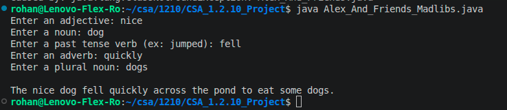

# CSA_1.2.10_Project
## Group: Rohan, Alex, Charles, Arjun, Hashim
### Roles:
**Rohan**: Team leader. Created the runner class.\
**Alex**: Created noun/plural noun class, team moral support and mascot.\
**Charles**: Created adjective class.\
**Hashim**: Created verb class.\
**Arjun**: Created adverb class.

### Description:
This is a MadLibs based project that takes in user input of different words and adds it into a story to make a completely personalized and custom story. 
It uses Object Oriented Programming concepts such as creating seperate files/classes to be able to create instances of the lass for repeated tasks in order to have cleaner, better abstracted, and easier to understand.

### Our Success:
We attribute our success to our ability to communicate and work together to solve issues without relying on AI. Our varying experitise in java, git, github, windows os, macos, and linux allowed us to ensure everyone had a proper understanding of the various concepts that real software programmers use daily.

### Code Examples:
